<div align="center">


### Construction Project Transparency & Management Platform

**One app. Three roles. One real-time record of what is happening on site.**

<br>


[**Overview**](#overview) ·
[**Screenshots**](#screenshots) ·
[**Features**](#features) ·
[**How it works**](#how-it-works) ·
[**Architecture**](#architecture) ·
[**Data model**](#data-model) ·
[**Setup**](#getting-started) ·
[**Team**](#team)

</div>

---

## Overview

**BuildTrack** is an Android application for small and mid-sized residential construction projects. It connects the three people who matter on a project, the **Manager**, the **On-site Engineer** and the **Buyer**, through a single cloud-backed app, so that progress, photos, documents and conversations live in one place instead of being scattered across WhatsApp groups, phone calls and site visits.

It was built as the mini-project for **Mobile Application Development** (B.Tech Artificial Intelligence & Data Science, Semester V, NMIMS).

| | |
|---|---|
| **Type** | Native Android app |
| **Language / UI** | Java, XML layouts, Material 3 theme |
| **Backend** | Firebase Authentication + Cloud Firestore (real-time) |
| **Roles** | Manager · On-site Engineer · Buyer |
| **Min / target SDK** | 24 (Android 7.0) / 36 |
| **Package** | `com.example.buildtrack_v1` |
| **Size** | 32 Java classes, 31 XML layouts |
| **Version** | 1.0 |

---

## The problem

On small residential projects, the information that decides trust and money travels through informal channels:

- **WhatsApp groups:** site photos and updates are buried under other messages.
- **Phone calls:** the manager phones engineers to ask "how far along are we?".
- **Physical visits:** managers and buyers travel to site just to see the progress.

<div align="center">
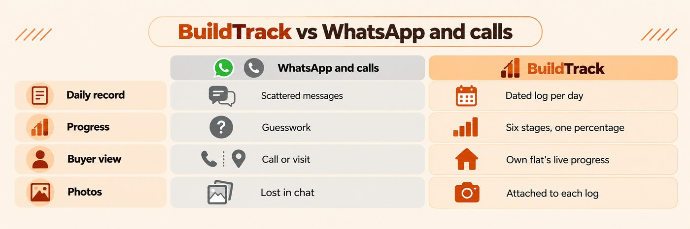
</div>

<br>

| Who is affected | What goes wrong |
|---|---|
| **Managers** | Cannot oversee several sites at once, and spend time chasing updates instead of managing. |
| **Site engineers** | Report informally, with no fixed format, so nothing is comparable from one day to the next. |
| **Buyers** | Have paid for a flat but cannot see real progress, so trust rests on someone's word. |

The result is familiar: **delays go unnoticed, messages get lost or misunderstood, payments are disputed, and handover dates are guessed.**

## Our solution

<div align="center">
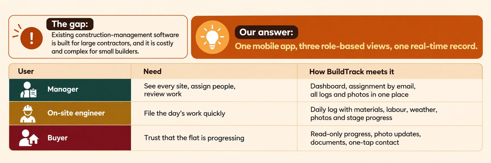
</div>

<br>

BuildTrack replaces the chats, calls and visits with **one mobile app, three role-based views and one real-time record**. The engineer records what happened on site, with photos. The manager sees it and steers the project. The buyer sees the live progress of their own flat, with proof, from anywhere.

<div align="center">
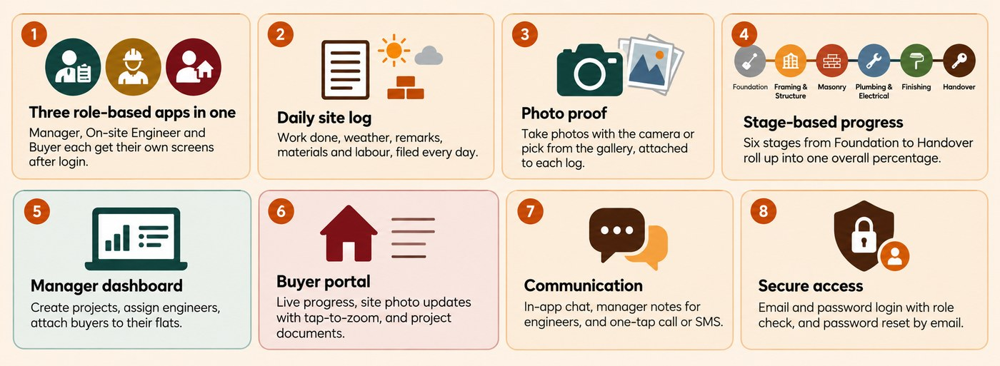
</div>

---

## Screenshots

<table>
  <tr>
    <td align="center">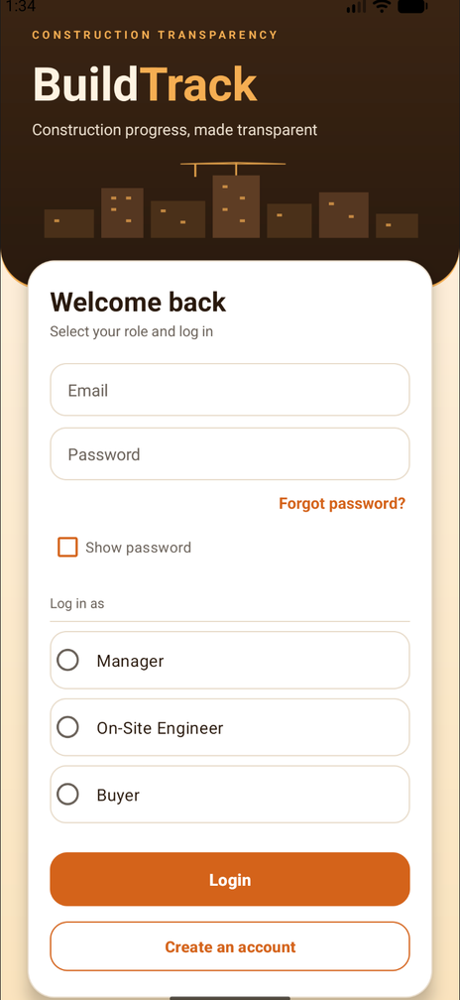<br><sub><b>Login</b><br>role picker, show password, forgot password</sub></td>
    <td align="center">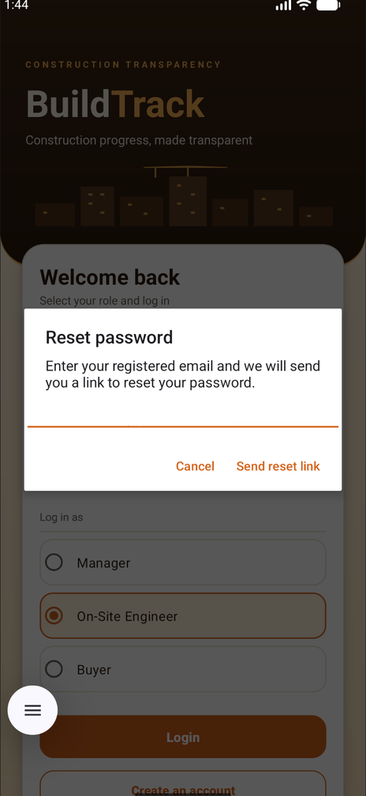<br><sub><b>Reset password</b><br>link sent by Firebase Auth</sub></td>
    <td align="center">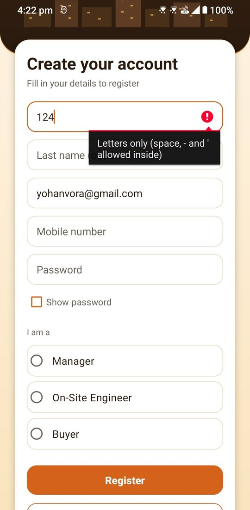<br><sub><b>Register</b><br>live field validation</sub></td>
  </tr>
  <tr>
    <td align="center">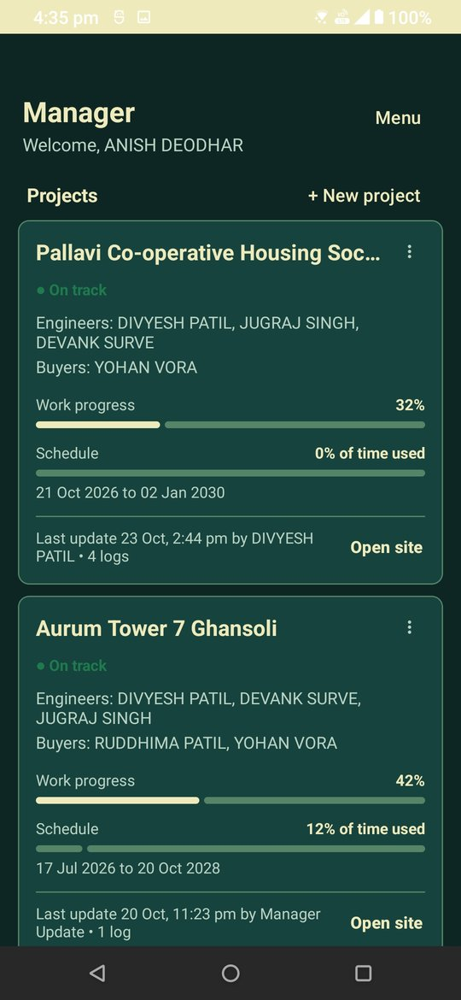<br><sub><b>Manager home</b><br>projects, team, work and schedule progress</sub></td>
    <td align="center">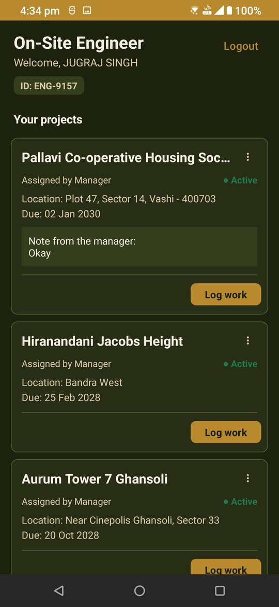<br><sub><b>Engineer home</b><br>engineer ID, assigned sites, manager's note, Log work</sub></td>
    <td align="center">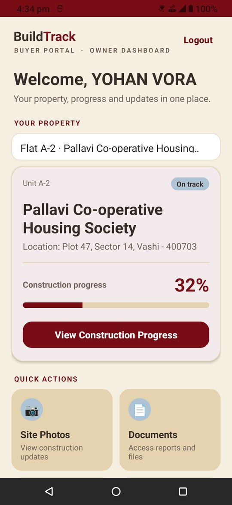<br><sub><b>Buyer home</b><br>flat selector, construction progress, photos and documents</sub></td>
  </tr>
</table>

<details>
<summary><b>Cloud Firestore console</b> (the live database behind the app)</summary>
<br>
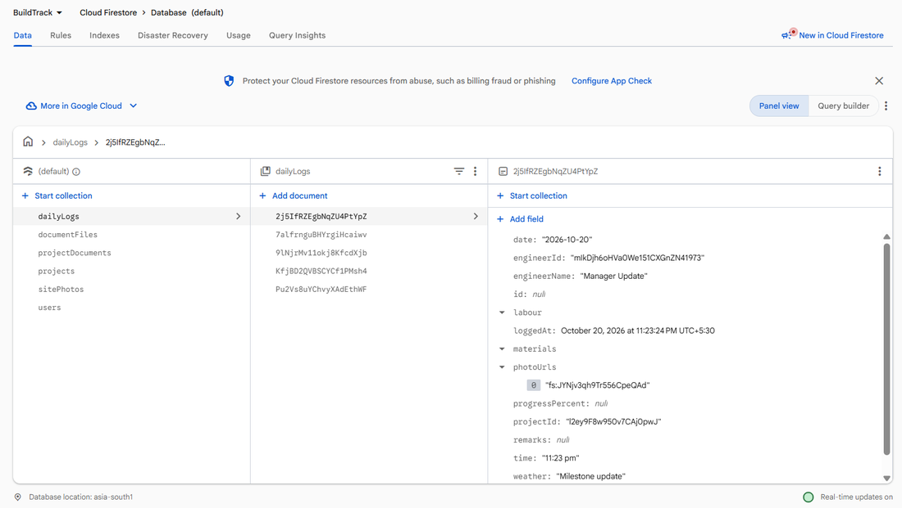
<br>
<sub>Collections: <code>dailyLogs</code>, <code>documentFiles</code>, <code>projectDocuments</code>, <code>projects</code>, <code>sitePhotos</code>, <code>users</code>. Chat messages live in a <code>messages</code> subcollection under each project.</sub>
</details>

---

## Features

### Role capabilities at a glance

| Capability | Manager | Engineer | Buyer |
|---|:---:|:---:|:---:|
| Register, log in, auto-login, forgot password | ✅ | ✅ | ✅ |
| Create and manage projects | ✅ | | |
| Assign engineers (by engineer ID) | ✅ | | |
| Assign buyers (by email) with one or more flat numbers | ✅ | | |
| See assigned sites live | ✅ | ✅ | ✅ (own flats) |
| File a daily log (weather, labour, materials, photos) | ✅ (updates) | ✅ | |
| Update stage-wise progress | ✅ | ✅ | |
| View progress, status and handover date | ✅ | ✅ | ✅ |
| Take a photo with the camera or pick from the gallery | ✅ | ✅ | |
| View site photos with pinch, drag and double-tap zoom | ✅ | ✅ | ✅ |
| Write the instruction note shown to engineers | ✅ | read | |
| Set the site helpline number | ✅ | | read |
| Upload and delete project documents | ✅ | | |
| Open project documents | ✅ | | ✅ |
| Project chat | ✅ | ✅ | ✅ |
| Call or SMS contact links between roles | ✅ | ✅ | ✅ |

<details>
<summary><b>Authentication and account safety</b></summary>

- Registration with first name, optional last name, email, mobile number, role and password.
- Login by email and password, with a check that the **role selected matches the role saved** on the account.
- **Auto-login:** the Firebase session is restored when the app reopens.
- **Forgot password:** a reset link is sent to the registered email through Firebase Authentication.
- **Show password** toggle and **Logout** from the home menu.
- Accounts created before mobile numbers were collected are asked once for the missing number, so call and SMS links are never dead.
- Passwords are handled entirely by Firebase Authentication and are never stored in the app database.

**Validation rules**

| Field | Rule |
|---|---|
| Name | Letters only (spaces, `-` and `'` allowed inside) |
| Email | Valid email format |
| Mobile | Valid 10-digit Indian mobile number, stored as bare digits so every call and SMS link is built the same way |
| Password | At least 6 characters with an upper-case letter, a lower-case letter and a digit. No spaces or underscores. Only `@ # $ % &` are accepted as special characters, and a password cannot start with one. |

</details>

<details>
<summary><b>Manager</b></summary>

- Create projects with name, location, start and end dates.
- **Assign people:** add an engineer by their generated ID, add a buyer by email and attach a **flat number**. A buyer who owns two flats is attached twice, once per flat.
- Remove an engineer, a buyer or a single flat.
- Dashboard cards show engineers, buyers, **work progress**, **schedule progress** (percentage of planned time used) and a status label.
- Adjust **stage-wise progress** with sliders.
- Post updates with a note and photos, from the **camera** or the **gallery**.
- Write an **instruction note** that every assigned engineer sees on their project card.
- Set the site **helpline number** (only the manager can change it).
- Review every engineer's logs for a site.
- **Documents:** upload images or files for buyers (up to 700 KB each) and delete them.
- Project **chat** with the team.

</details>

<details>
<summary><b>On-site Engineer</b></summary>

- A readable **engineer ID** (for example `ENG-1234`), derived from the Firebase account so it is identical on every device. A manager can assign work with this code before the engineer ever opens the app.
- **Live list of assigned sites:** it refreshes the moment the manager assigns or removes one.
- **Daily log:** date, weather, labour rows, material rows, remarks and **multiple photos**.
- **Log history** per site.
- Update **stage progress**.
- Post photo updates with the **camera** or the **gallery**.
- Project **chat**.

</details>

<details>
<summary><b>Buyer</b></summary>

- A **spinner of every flat** the buyer owns, labelled "Flat X · Project". Selecting one shows that flat's data.
- **Construction progress** (percentage) with a status and the planned handover date.
- **Updates feed:** what the engineers and manager posted, newest first, with materials spelled out ("60 bags", not "60.0 bags").
- **Site photos** with tap-to-zoom.
- **Documents:** images open in the zoom viewer, other files open in the phone's default app.
- **Contact** options: call or message the manager, and the site helpline.
- Project **chat**.

</details>

<details>
<summary><b>Progress model</b></summary>

Every site is tracked through six stages, each from 0 to 100%:

`Foundation` → `Framing & Structure` → `Masonry` → `Plumbing & Electrical` → `Finishing` → `Handover`

**Overall progress is the mean of the six stages.** It is calculated, never estimated or pre-filled, and the same number is shown to the manager, engineer and buyer. Schedule progress is the share of the planned time (start to end date) that has passed, and the status label compares the two.

</details>

---

## How it works

### Roles and data flow

<div align="center">
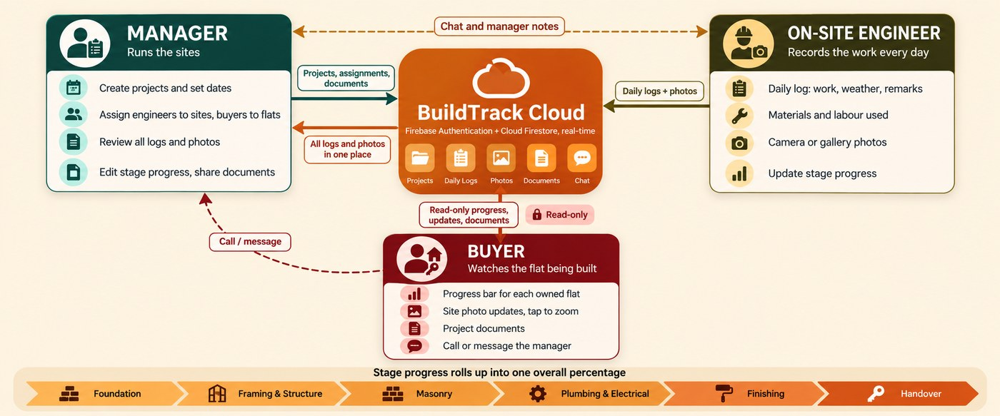
</div>

### App flow

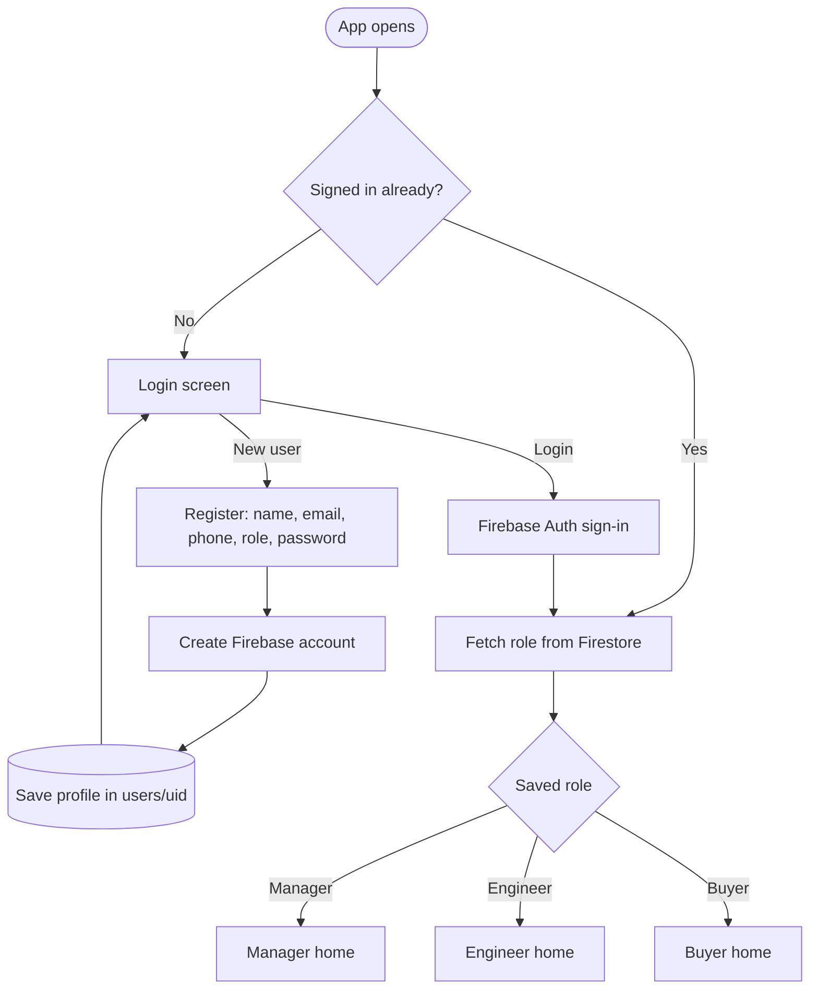

### From site to buyer, in real time

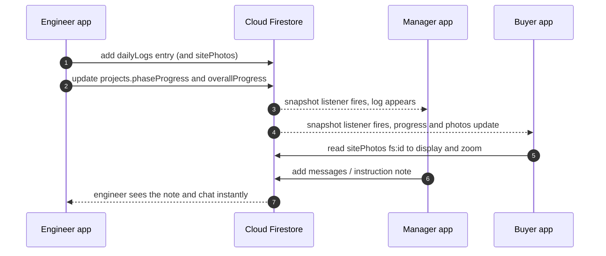

### One project, end to end

1. The **manager** registers, logs in and creates a project.
2. The **engineer** registers and shares their generated **engineer ID**. The manager adds it under *Assign people*.
3. The manager adds the **buyer's email** with a **flat number**.
4. The engineer's home screen shows the site immediately (live listener).
5. On site, the engineer files a **daily log** with photos and updates the **stage progress**.
6. **Overall progress** is recalculated and shown to everyone.
7. The manager reads the logs, writes an **instruction note**, uploads **documents** and chats with the team.
8. The **buyer** picks a flat and sees its progress, zoomable photos, updates and documents.

---

## Architecture

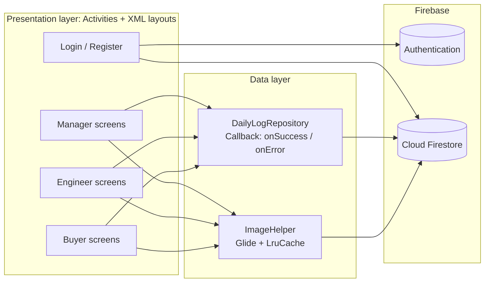

| Layer | Responsibility |
|---|---|
| **Presentation** | One Activity and one XML layout per screen. RecyclerView adapters for lists. Role themes applied with `setTheme()` before `setContentView()`. |
| **Data** | `DailyLogRepository` is the main access point to Firestore and exposes a `Callback<T>` interface, so screens never handle raw Firebase calls. `MainActivity`, `RegisterActivity`, `ImageHelper` and `DocumentsActivity` also call Firebase directly for login, registration and file or photo loading. |
| **Backend** | Firebase Authentication for identity, Cloud Firestore for data, real-time through snapshot listeners that are removed when a screen closes. |

---

## Data model

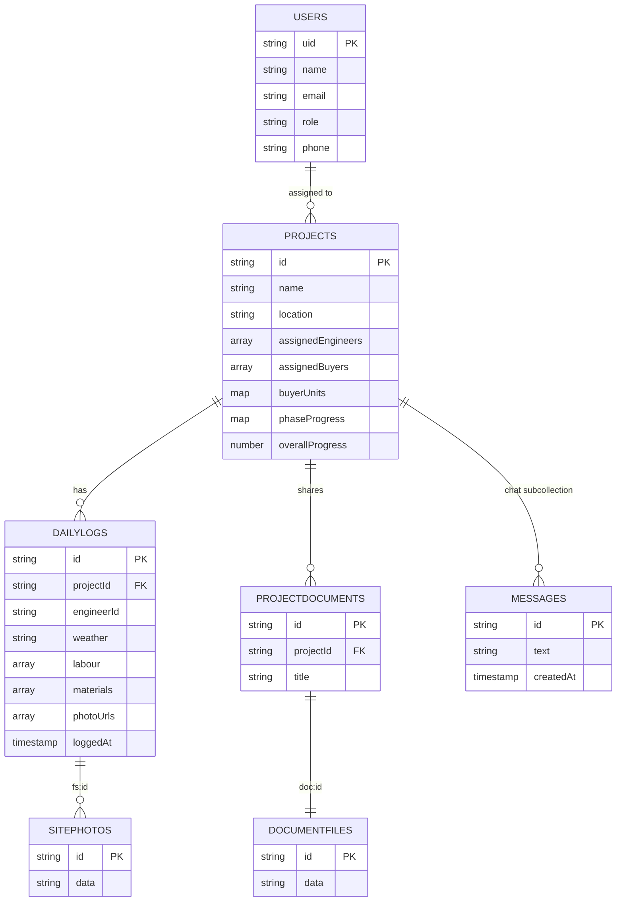

| Collection | Purpose |
|---|---|
| `users` | Profile for each account (document ID = Firebase UID). |
| `projects` | Project details, team lists, `buyerUnits` (buyer UID to list of flats), `phaseProgress` (six stages) and `overallProgress`. |
| `projects/{id}/messages` | **Subcollection** holding that project's chat. |
| `dailyLogs` | Engineer logs. Photos are referenced as `fs:<docId>`. |
| `sitePhotos` | Compressed JPEG photos stored as Base64. |
| `projectDocuments` | Document metadata for buyers. |
| `documentFiles` | Document bytes stored as Base64, referenced as `doc:<id>`. |

**Operations used:** `add`, `set`, `update`, `get`, `delete`, `whereEqualTo`, `orderBy`, `FieldValue.serverTimestamp()`, `FieldValue.arrayUnion` / `arrayRemove`, dot-notation map updates (`buyerUnits.<uid>`) and `addSnapshotListener`.

---

## Engineering decisions

| Decision | Why |
|---|---|
| **Cloud Firestore, not the Realtime Database** | Collections and documents fit projects, logs and chat. Better queries, and still real-time through snapshot listeners. |
| **Photos and files as Base64 in Firestore** | Firebase Storage needs a paid plan for this project. Photos are scaled and compressed to JPEG and files are capped at 700 KB, which keeps each document under Firestore's 1 MiB limit. |
| **Overall progress = mean of six stages** | One honest number everyone shares, with nothing estimated. |
| **Engineer ID derived from the Firebase UID** | The manager can assign an engineer before first login, and the ID is the same on every device. |
| **Repository with callbacks** | Keeps database code out of the screens and makes it reusable. |
| **Client-side filtering of project lists** | Avoids composite indexes and keeps queries simple at this scale. |
| **Listeners removed in `onStop` / `onDestroy`** | Prevents leaks and wasted reads. |
| **Role themes through theme attributes (`?attr/...`)** | One layout, three identities, with no hard-coded colours. |
| **`buyerUnits` as a map of lists** | A buyer with several flats gets a separate card for each, from a single account. |
| **ActivityResult API + FileProvider for the camera** | The current, supported way to capture a photo without a storage permission. |

---

## Android concepts used

| Taught in the course | Learned and applied for this project |
|---|---|
| Java and OOP | Firebase Authentication |
| XML layouts: Linear, Relative, Scroll, Constraint | Cloud Firestore (CRUD, queries, subcollections, live listeners) |
| Activities and Intents with extras | RecyclerView, adapters, ViewHolder, LayoutManager |
| TextView, EditText, Button, ImageView | Material 3 cards, progress indicators, SeekBar sliders |
| Spinner, RadioGroup / RadioButton, CheckBox | Glide image loading |
| Toast, AlertDialog | Camera and gallery with the ActivityResult API and FileProvider |
| Input validation with regular expressions | Custom view `ZoomImageView` (Matrix, ScaleGestureDetector, GestureDetector) |
| | Role-based themes, popup menus, lambdas and callback interfaces |

---

## Project structure

```
BuildTrack_v1/
├── app/
│   ├── google-services.json            # Firebase configuration
│   └── src/main/
│       ├── AndroidManifest.xml         # activities, role themes, FileProvider, INTERNET
│       ├── java/com/example/buildtrack_v1/
│       │   ├── MainActivity            # login, auto-login, forgot password
│       │   ├── RegisterActivity        # sign-up and validation
│       │   ├── Manager*  Project*  AssignPeople  Comments  PostUpdate  PhaseProgress
│       │   ├── Engineer*  DailyLogEntry  LogHistory*
│       │   ├── Buyer*  Progress  UpdatesFeed
│       │   ├── DocumentsActivity       # manager upload, buyer view
│       │   ├── ChatActivity / ChatAdapter
│       │   ├── PhotoViewerActivity / ZoomImageView / ImageHelper
│       │   └── DailyLogRepository, UiTheme, ProgressUtil, MobileNumber, EngineerIdentity
│       └── res/
│           ├── layout/                 # 31 XML layouts
│           ├── menu/                   # home and project action menus
│           ├── values/                 # colours, strings, role themes
│           └── xml/                    # FileProvider paths, backup rules
├── docs/                               # README images
├── build.gradle.kts
└── settings.gradle.kts
```

---

## Getting started

### Prerequisites

- Android Studio (recent version) with the bundled JDK
- An Android phone or emulator running Android 7.0 (API 24) or higher
- Internet access

### Run the project

```bash
git clone https://github.com/yohanvoraa-wq/BuildTrack_v1.git
```

1. Open the folder in **Android Studio** and let Gradle sync.
2. **Firebase:** the project reads `app/google-services.json`. To use your own Firebase project instead:
   - create a project in the Firebase console and add an Android app with the package `com.example.buildtrack_v1`;
   - enable **Authentication → Sign-in method → Email/Password**;
   - create a **Cloud Firestore** database;
   - download `google-services.json` into `app/`.
3. Press **Run** on a device or emulator.

> Camera capture and photo zoom are best tried on a real phone.

### Suggested demo walkthrough

1. Register three accounts: one **Manager**, one **Engineer**, one **Buyer**.
2. As the **Manager**, create a project, then open *Assign people*. Add the engineer's ID and the buyer's email with a flat number (add a second flat to see the multi-flat view).
3. As the **Engineer**, open the site, file a **daily log** with a photo from the camera, and move a stage slider.
4. As the **Manager**, watch the log arrive, write an instruction note, and upload a document.
5. As the **Buyer**, pick a flat, view the progress, tap a photo to zoom, open the document, and send a chat message.

---

## Security and known limitations

| Area | Status |
|---|---|
| **Firestore rules** | The database was created in *test mode* (open access that expires on a date shown in the console). Production use needs at least `request.auth != null`, then per-role rules. |
| **Whole-collection listeners** | Project lists are read in full and filtered on the phone. This is simple but does not scale and reads more data than a user needs. Server-side queries and rules are the fix. |
| **Base64 files in Firestore** | Suitable for small photos and documents (about 1 MiB per document). A production version would use cloud object storage. |
| **Free-tier quotas** | Firestore's daily free quotas apply to reads, writes and deletes, plus total storage. |
| **API key** | The key in `google-services.json` identifies the Firebase project and is not a secret. Protection comes from Authentication and security rules. |
| **Passwords** | Handled only by Firebase Authentication. |

---

## Roadmap

**Delivered in v1.0**

- [x] Email and password authentication, auto-login, password reset
- [x] Role-based access and role-based themes
- [x] Project creation, engineer and buyer assignment, multi-flat buyers
- [x] Daily logs with weather, labour, materials and multiple photos
- [x] Six-stage progress with calculated overall percentage and schedule status
- [x] Camera and gallery capture
- [x] Tap-to-zoom photo viewer
- [x] Project chat
- [x] Buyer documents module
- [x] Call and SMS contact links, site helpline

**Planned**

- [ ] Role-based Firestore security rules
- [ ] Push notifications for new logs, photos and messages
- [ ] Cloud file storage for large photos, videos and PDFs
- [ ] Offline support and sync
- [ ] Budget and material cost tracking with PDF export
- [ ] Server-side queries and pagination for large projects
- [ ] Multi-language support
- [ ] Builder dashboard across many projects

---

## FAQ

<details>
<summary><b>Is this the Realtime Database?</b></summary>

No. BuildTrack uses **Cloud Firestore**. It is real-time in behaviour because screens attach snapshot listeners, but it is a different product from the Firebase Realtime Database.
</details>

<details>
<summary><b>Why are photos stored inside Firestore?</b></summary>

Firebase Storage is not available on the free plan for this project. Photos are scaled and compressed to JPEG, then stored as Base64 in their own documents and referenced from logs (`fs:<docId>`), which keeps every document well under Firestore's size limit.
</details>

<details>
<summary><b>How does a buyer see only their own flat?</b></summary>

The manager attaches a flat number to each buyer in `buyerUnits` (buyer UID to a list of flats). The buyer's spinner is built from the projects that list their UID, with one entry per flat.
</details>

<details>
<summary><b>How is overall progress computed?</b></summary>

As the mean of the six stage values that the engineer and manager maintain. Nothing is estimated or pre-filled.
</details>

<details>
<summary><b>What happens to users who forget their password?</b></summary>

*Forgot password?* on the login screen asks for the registered email and Firebase sends a reset link.
</details>

---

## Team

| Member | Contribution |
|---|---|
| **Yohan Vora** (Team Lead) | Architecture, Firebase integration, photo zoom, camera and gallery, multi-flat buyers, final integration and presentation |
| **Ruddhima Patil** | Manager screens and workflow |
| **Aadi Samal** | Engineer and buyer screens, presentation draft, engineer and buyer modules, chat, documents, |

**Course:** Mobile Application Development · B.Tech AI & Data Science, Semester V · NMIMS
**Faculty:** Dr. Preeti Gupta

## Acknowledgements

- [Firebase](https://firebase.google.com/) for Authentication and Cloud Firestore
- [Glide](https://github.com/bumptech/glide) for image loading
- [Material Components for Android](https://github.com/material-components/material-components-android)
- Our faculty, for guidance throughout the course

---

<div align="center">

**BuildTrack:** one place where everyone on a construction project sees the same truth.

</div>
